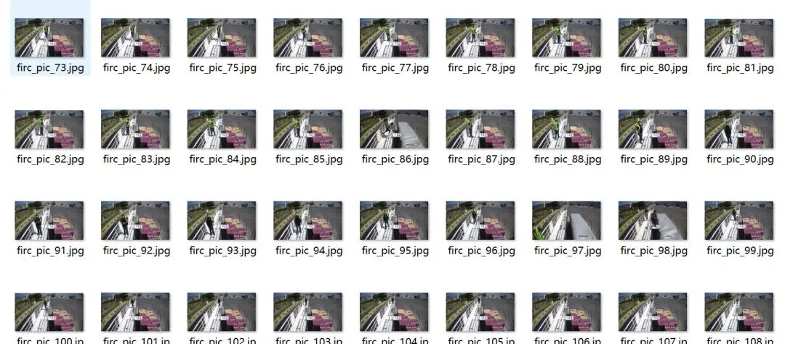
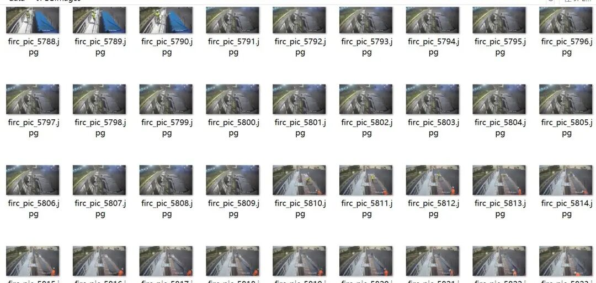
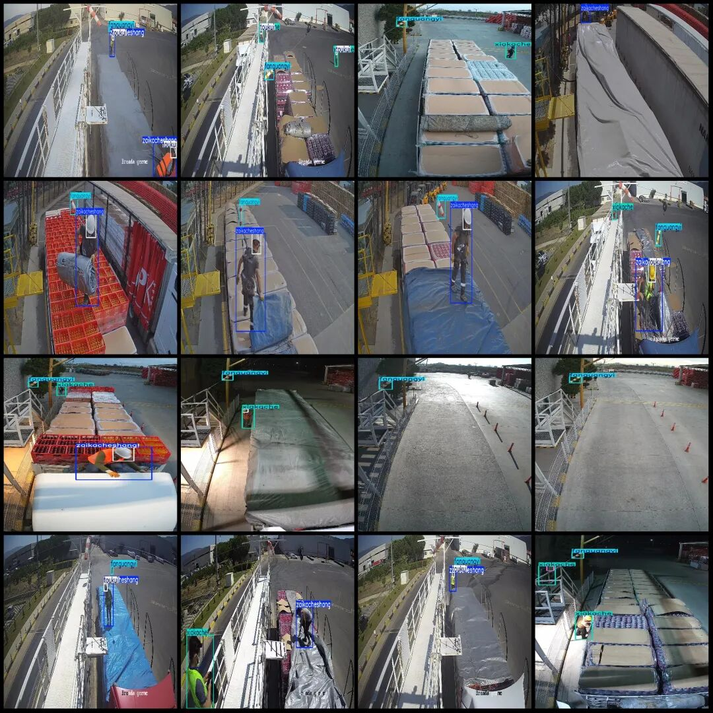
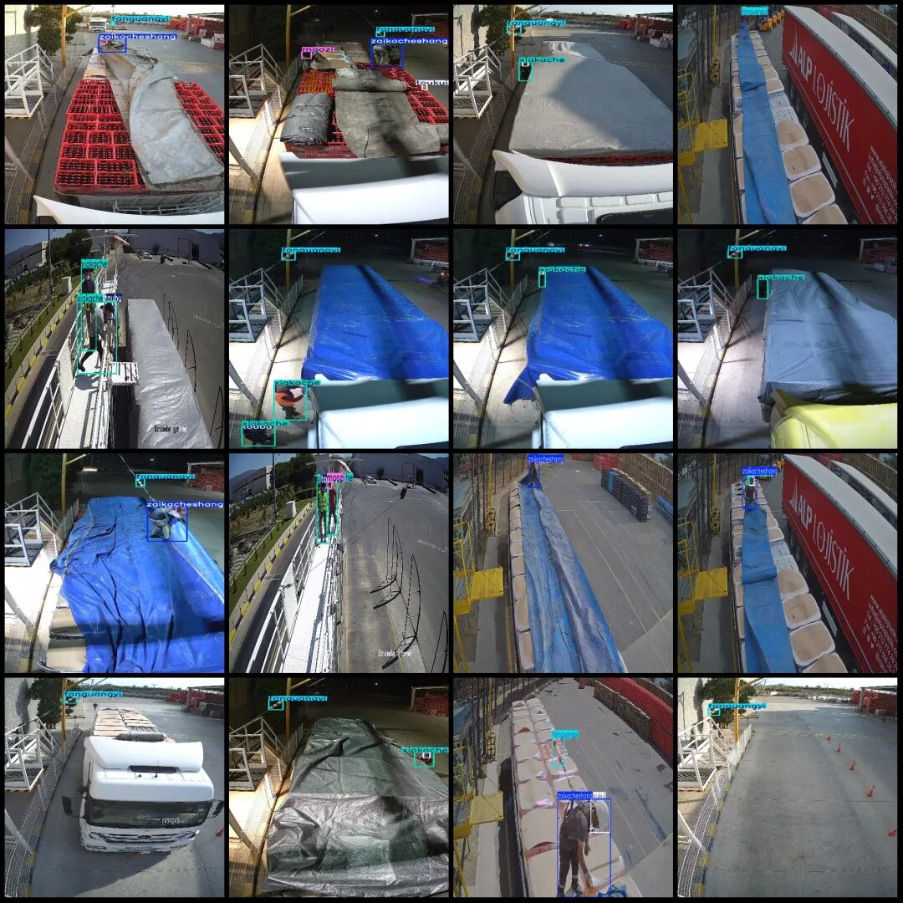

# Intelligent Logistics High-Definition Image Data Set for Safety Helmet and Reflective Clothing Status Detection in Logistics Sites - VOC+YOLO format with 6 categories, 6847 images.

Dataset format: Pascal VOC format + YOLO format (txt file without split path, only containing jpg images and corresponding VOC format xml files and yolo format txt files)

Number of images (number of jpg files): 6847

Number of annotations (number of xml files): 6847

Number of annotations (number of txt files): 6847

Label count: 6

Label category names (Note that the order of categories in the YOLO format does not correspond to this, but is based on the labels folder's classes.txt): ["fanguangyi", "maozi", "toubu", "toukui", "xiakache", "zaikacheshang"]

Category: ["reflective vest", "hat", "head", "helmet", "under-truck", "on-truck"]

Number of boxes labeled in each category:

fanguangyi frame count = 6376

Maozi Frame Count = 1225

Toubu Frame Count = 1413

Toukui Frames = 3991

Xiakache Frames = 3906

Zaikacheshang Frames = 3627

Total frames: 20538

Number of images per category:

Fangguangyi's possession of images = 6376

Maozi's total number of images = 1210

Toubu's number of images = 1155

Toukui's total number of images = 3616

Xiakache owns 3301 images.

Zaikacheshang's possession of images = 3404

Image resolution: 960x540

Using labelImg:

Annotation rules: Draw a rectangle around the category.

Important Notice: The dataset does not have separate training, validation, and test sets; you need to partition them yourself.

Special : This dataset does not guarantee the accuracy of the trained models or weight files.

Image Preview:

Annotation example:

## Payment

Here is a pay link on Stripe ( https://buy.stripe.com/3cs8yP7sY87d0vu9AB ). Please contact me lonlonago@foxmail.com after funding $89, and I will send you a complete data files , thank you!

